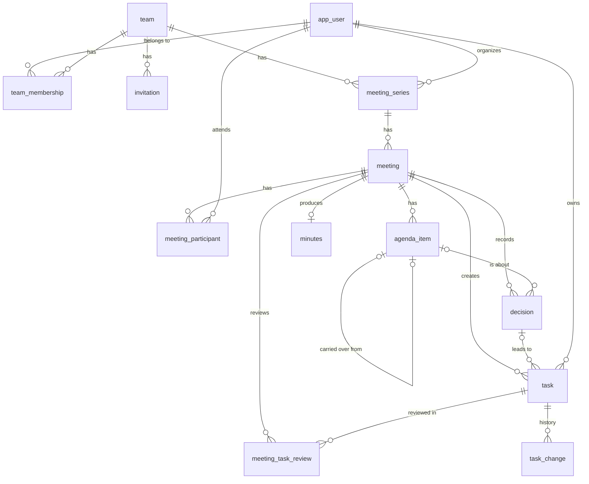

# MeetFlow – Data Model

The data model for the MVP (MF-30). It implements the rules in `docs/core-flow.md` on the stack in `docs/architecture.md`: one PostgreSQL database, with tables owned by the backend modules. MF-31 turns it into the first Flyway migrations.

## Conventions

- **IDs** are UUIDs generated by the application, so they can't be guessed or enumerated.
- **Timestamps** are `timestamptz`, stored in UTC. Task **deadlines** are a calendar `date`.
- **Enums** are stored as `text` with a `CHECK` constraint, so adding a value only needs a migration.
- **Optimistic locking**: tables edited by several people (`meeting`, `agenda_item`, `task`) have a `version` column, so concurrent edits fail cleanly instead of overwriting each other.
- **Team scoping**: every table holding team content has a `team_id`, or reaches one through a required parent (see *Team scoping*).
- **Module ownership**: each table belongs to one module. Foreign keys may cross modules to protect integrity, but code reads and writes another module's tables only through that module's API.
- **Text limits** (enforced in the API and the database): names 100 characters, titles 200, task descriptions 500, decisions 2,000, notes 10,000, email addresses 254.

## Diagram

## Tables

### `identity` module

**`app_user`** – a person with an account.

| Column | Type | Notes |
|---|---|---|
| `id` | uuid | PK |
| `email` | text | unique, stored lowercased; null once the account is deleted |
| `name` | text | not null |
| `password_hash` | text | bcrypt; null once the account is deleted |
| `created_at` | timestamptz | |
| `deleted_at` | timestamptz | set when the account is deleted (see *GDPR*) |

Sessions are stored in the standard Spring Session JDBC tables (`spring_session`, `spring_session_attributes`). They are not part of this model, except that `principal_name` is widened from 100 to 254 characters so it fits any email address.

### `teams` module

**`team`**

| Column | Type | Notes |
|---|---|---|
| `id` | uuid | PK |
| `name` | text | not null |
| `created_by` | uuid | FK `app_user` |
| `created_at` | timestamptz | |

**`team_membership`** – a user's membership and role in a team.

| Column | Type | Notes |
|---|---|---|
| `team_id` | uuid | PK part, FK `team` |
| `user_id` | uuid | PK part, FK `app_user` |
| `role` | text | `ADMIN` or `MEMBER` |
| `joined_at` | timestamptz | |

- Removing a member deletes the row. Their past participations, decisions and task history stay, because those reference `app_user`, not the membership.
- "A team always has at least one admin" is checked in the service when a role changes or a member is removed.

**`invitation`** – a single-use invitation sent by email.

| Column | Type | Notes |
|---|---|---|
| `id` | uuid | PK |
| `team_id` | uuid | FK `team` |
| `email` | text | the invitee's address, lowercased |
| `token_hash` | text | unique; SHA-256 of the token in the link (the token itself is never stored) |
| `invited_by` | uuid | FK `app_user` |
| `created_at` | timestamptz | |
| `expires_at` | timestamptz | `created_at` + 7 days |
| `accepted_at` | timestamptz | set on use; a used or expired invitation is rejected |
| `accepted_by` | uuid | FK `app_user`, nullable |

### `meetings` module

**`meeting_series`**

| Column | Type | Notes |
|---|---|---|
| `id` | uuid | PK; unique (`id`, `team_id`) for composite FKs |
| `team_id` | uuid | FK `team` |
| `name` | text | not null |
| `organizer_id` | uuid | FK `app_user`; must be a team member (service check) |
| `created_at` | timestamptz | |

**`meeting`**

| Column | Type | Notes |
|---|---|---|
| `id` | uuid | PK; unique (`id`, `team_id`) and (`id`, `series_id`) for composite FKs |
| `team_id` | uuid | |
| `series_id` | uuid | FK (`series_id`, `team_id`) → `meeting_series` (`id`, `team_id`) |
| `scheduled_at` | timestamptz | |
| `status` | text | `SCHEDULED`, `IN_PROGRESS` or `CLOSED` |
| `started_at`, `closed_at` | timestamptz | |
| `closed_by` | uuid | FK `app_user`, nullable |
| `version` | bigint | |

- A partial unique index allows **at most one meeting that isn't `CLOSED` per series**. This makes "the previous meeting" well defined for carry-over (see *Carry-over*).
- `CHECK` constraints keep the timestamps consistent with the status: a `SCHEDULED` meeting has none of them, an `IN_PROGRESS` one has only `started_at`, and a `CLOSED` one has `started_at`, `closed_at` and `closed_by`.
- Only a `SCHEDULED` meeting can be deleted.

**`meeting_participant`**

| Column | Type | Notes |
|---|---|---|
| `meeting_id` | uuid | PK part, FK `meeting` |
| `user_id` | uuid | PK part, FK `app_user`; a team member when added (service check) |

**`agenda_item`**

| Column | Type | Notes |
|---|---|---|
| `id` | uuid | PK; unique (`id`, `team_id`) and (`id`, `meeting_id`) for composite FKs |
| `team_id` | uuid | FK (`meeting_id`, `team_id`) → `meeting` |
| `meeting_id` | uuid | |
| `position` | int | order on the agenda; unique (`meeting_id`, `position`), deferrable so items can be reordered |
| `title` | text | not null |
| `notes` | text | notes taken during the meeting |
| `status` | text | `PENDING`, `COVERED` or `NOT_COVERED` |
| `carried_over_from_id` | uuid | nullable: the uncovered item this one was copied from; FK (`carried_over_from_id`, `team_id`) → `agenda_item`, so it is in the same team |
| `version` | bigint | |

**`decision`**

| Column | Type | Notes |
|---|---|---|
| `id` | uuid | PK; unique (`id`, `meeting_id`) for composite FKs |
| `team_id` | uuid | FK (`meeting_id`, `team_id`) → `meeting` |
| `meeting_id` | uuid | |
| `agenda_item_id` | uuid | nullable; FK (`agenda_item_id`, `meeting_id`) → `agenda_item`: an item of the same meeting |
| `text` | text | not null |
| `created_by` | uuid | FK `app_user` |
| `created_at` | timestamptz | |
| `search_vector` | tsvector | generated from `text`; GIN index for history search |

### `tasks` module

**`task`** – a commitment.

| Column | Type | Notes |
|---|---|---|
| `id` | uuid | PK; unique (`id`, `series_id`) and (`id`, `team_id`) for composite FKs |
| `team_id` | uuid | FK (`series_id`, `team_id`) → `meeting_series` |
| `series_id` | uuid | the series the task carries over in: always the meeting's series, FK (`meeting_id`, `series_id`) → `meeting` |
| `meeting_id` | uuid | the meeting where the task was created |
| `decision_id` | uuid | nullable; FK (`decision_id`, `meeting_id`) → `decision`: a decision of the same meeting |
| `agenda_item_id` | uuid | nullable; FK (`agenda_item_id`, `meeting_id`) → `agenda_item`: an item of the same meeting |
| `description` | text | not null |
| `owner_id` | uuid | FK `app_user`, **not null**: exactly one owner, always |
| `deadline` | date | not null |
| `status` | text | `OPEN`, `IN_PROGRESS` or `DONE` |
| `created_by` | uuid | FK `app_user` |
| `created_at`, `updated_at` | timestamptz | |
| `deleted_at`, `deleted_by` | timestamptz, uuid | set when an admin deletes a removed member's task |
| `version` | bigint | |

- When a task is created, its owner must be a participant of `meeting_id` (service check).
- **Overdue** is not stored. A task is overdue when it isn't `DONE` and `deadline` is before the current date: today for the viewer on the dashboard, and the meeting date on the agenda and in the minutes.
- Index on (`owner_id`, `status`, `deadline`) for the pending-tasks dashboard, and on (`series_id`, `status`) for carry-over.

**`task_change`** – the status history. One row per change, including the creation.

| Column | Type | Notes |
|---|---|---|
| `id` | uuid | PK |
| `task_id` | uuid | FK (`task_id`, `team_id`) → `task` |
| `team_id` | uuid | the task's team, so the meeting can be checked against it |
| `changed_by` | uuid | FK `app_user` |
| `changed_at` | timestamptz | |
| `meeting_id` | uuid | nullable: set when the change was made during a meeting; FK (`meeting_id`, `team_id`) → `meeting`: a meeting of the task's team |
| `old_status`, `new_status` | text | null when the status didn't change |
| `old_owner_id`, `new_owner_id` | uuid | null when the owner didn't change |
| `old_deadline`, `new_deadline` | date | null when the deadline didn't change |

Rows are only inserted, never updated or deleted.

**`meeting_task_review`** – the carried-over tasks reviewed in a meeting.

| Column | Type | Notes |
|---|---|---|
| `meeting_id` | uuid | PK part, FK (`meeting_id`, `series_id`) → `meeting` |
| `task_id` | uuid | PK part, FK (`task_id`, `series_id`) → `task` |
| `series_id` | uuid | the series of both the meeting and the task, so a task is only reviewed in its own series |
| `status_at_close` | text | filled when the meeting closes, for the minutes |

### `minutes` module

**`minutes`**

| Column | Type | Notes |
|---|---|---|
| `id` | uuid | PK |
| `team_id` | uuid | FK (`meeting_id`, `team_id`) → `meeting` |
| `meeting_id` | uuid | unique: one set of minutes per meeting |
| `generated_at` | timestamptz | |
| `content` | jsonb | snapshot of the meeting at closing (see *Read-only minutes*) |

History search uses `decision.search_vector` and a matching generated `tsvector` on `meeting_series.name`. Both use PostgreSQL's `simple` text configuration, because customers may write in any language.

### `notifications` module

Emails are triggered by events (invitation created, meeting closed). Spring Modulith's event publication table makes them reliable: an event is retried until its listener succeeds.

**`email_delivery`** – a record of the emails sent, so none is sent twice.

| Column | Type | Notes |
|---|---|---|
| `id` | uuid | PK |
| `kind` | text | `INVITATION`, `MINUTES` or `TASK_SUMMARY` |
| `reference_id` | uuid | the invitation or meeting the email is about |
| `recipient_email` | text | |
| `sent_at` | timestamptz | |
| `provider_message_id` | text | the SES message ID |

Unique (`kind`, `reference_id`, `recipient_email`): each owner gets one task email per meeting. Email bodies are not stored.

## How the rules are supported

### Carry-over within a series

1. A series can have at most one meeting that isn't closed, so the previous meeting is always the latest `CLOSED` one.
2. **Agenda items**: when a meeting is created, each agenda item of the previous meeting with status `NOT_COVERED` is copied into the new meeting with `carried_over_from_id` set. The organizer can remove these copies. When a meeting closes, its `PENDING` items become `NOT_COVERED`.
3. **Tasks**: when a meeting is created, a `meeting_task_review` row is added for every task of the series that isn't done or deleted. These rows have no delete endpoint, so open tasks can't be removed from the agenda. If a task is reopened while the next meeting is already scheduled, it is added to that meeting's list.
4. Tasks are not copied. One `task` row lives until it is done, so a commitment keeps its identity and full history across meetings.

### One owner per task

`task.owner_id` is `NOT NULL`. Removing a team member is rejected while they own tasks that aren't done in that team, or organize one of its series. The admin first reassigns or deletes those tasks (the deletion sets `deleted_at`), then reassigns the series.

### Locked closed meetings

Once `meeting.status` is `CLOSED`, the `meetings` and `tasks` services reject any change to its participants, agenda items, notes and decisions, and the creation of new tasks in it. A task's status can still be updated, and so can its owner and deadline when the organizer changes them. Each rule has a backend test.

### Read-only minutes

`minutes.content` is written once, when the meeting closes. It holds the participants, agenda, notes, decisions, new tasks and the status of reviewed tasks as they were at that moment. People are stored by user ID, and names are resolved when the minutes are shown, so a deleted account appears anonymized. The application has no update path for minutes, and a database trigger rejects `UPDATE` on the table.

### Status history

Every change to a task inserts a `task_change` row, in the same transaction as the change. The minutes and the meeting history read it to show how a commitment evolved.

## Team scoping

Every record reaches exactly one team, which the backend checks against the user's memberships on every request.

| Table | Team reached through |
|---|---|
| `team_membership`, `invitation`, `meeting_series` | `team_id` |
| `meeting`, `agenda_item`, `decision`, `task`, `task_change`, `minutes` | `team_id`, kept consistent with the parent by composite foreign keys |
| `meeting_participant`, `meeting_task_review` | `meeting_id` → `meeting.team_id` |
| `email_delivery` | `reference_id` → `invitation` or `meeting` (internal only, never exposed by the API) |
| `app_user` | not team-scoped. Users see the name and email of people who share a team with them. |

Because `team_id` is a direct column on the main tables, access checks are a plain `WHERE team_id IN (…)`, with no long joins. The composite foreign keys rule out links across teams: a decision or task can't point to another team's meeting, a task's decision and agenda item belong to its own meeting, a task carries over in its meeting's series, a carried-over agenda item comes from the same team, a task is only reviewed in meetings of its own series, and a task change made during a meeting points to a meeting of the task's team.

## GDPR

### Personal data fields

| Table | Fields | Purpose |
|---|---|---|
| `app_user` | `email`, `name`, `password_hash` | account and login |
| `invitation` | `email` | invite a person who may not have an account yet |
| `email_delivery` | `recipient_email` | avoid duplicate emails |
| `spring_session*` | session ID, user reference | keep the user logged in |
| `agenda_item.notes`, `agenda_item.title`, `decision.text`, `task.description`, `minutes.content` | free text written by customers, which may mention people | the meeting content itself |
| `*_by`, `owner_id`, `meeting_participant` | user references | who did what |

Free text is customer content: MeetFlow processes it on the customer's behalf and never writes it to logs.

### Retention and deletion

- **Account deletion**: the user is anonymized, not deleted. `name` becomes "Deleted user", `email` and `password_hash` are cleared, `deleted_at` is set and their sessions are removed. References in meetings and history stay valid. The same preconditions as removing a member apply in every team they belong to.
- **Invitations** are deleted 30 days after they expire or are accepted.
- **`email_delivery`** rows are deleted after 90 days.
- **Sessions** expire after inactivity, as configured in Spring Session.
- Deleting a whole team and its data is a manual operation in the MVP, handled on request.

## Decisions

Product rules settled while modeling (MF-30):

1. **One open meeting per series.** The next meeting can only be created once the previous one is closed. Without this rule, carry-over from a meeting that is still running would be ambiguous.
2. **Pending agenda items become "not covered" on closing**, so nothing is lost if the organizer forgets to mark them.
3. **Deleted tasks are soft-deleted** (`deleted_at`), so their history and the meetings that reviewed them stay intact.
4. **Account deletion anonymizes the user** instead of deleting the row, so meeting records keep their integrity.
